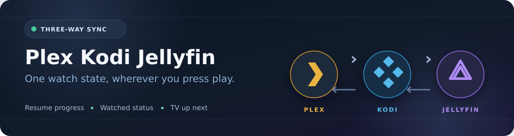

# Plex Kodi Jellyfin Sync

Sync movie and TV playback progress and watched status among **Plex, Kodi, and Jellyfin**. The container runs a periodic sync every 15 minutes and serves the existing Flask dashboard, webhook, status, and tracker pages on port 5000.

 Plex, Kodi, and Jellyfin use the same media files. The sync script matches items by relative media path, compares each platform against its previous snapshot, and applies a single detected change to the others. Conflicting changes are reported and left for review. On Deck / Up Next is reserved for unwatched TV episodes; an unwatched movie is not labeled Up Next.

## Connections

| Platform | Authentication and read/write methods |
| --- | --- |
| Plex | Server URL and `PLEX_TOKEN`; PlexAPI reads library items and On Deck, with Plex progress endpoints for updates. |
| Kodi | MariaDB credentials for video items and bookmarks, plus authenticated JSON-RPC for the Kodi WebUI. |
| Jellyfin | Server URL and `JELLYFIN_TOKEN` / `JELLYFIN_USER_ID`; an invalid token can be refreshed with `JELLYFIN_USER` and `JELLYFIN_PW`. Jellyfin user item and user-data endpoints read and update playback state. |

All setting names remain in [`app/config/.env-template`](app/config/.env-template). Copy it to a host-mounted `/config/.env`, fill in your own credentials, and set the three media roots so the same file resolves to the same relative path on each platform. Keep `/config/.env` and the state JSON out of Git.

## Docker Compose

Edit the host paths in [`docker-compose.yml`](docker-compose.yml), then run:

```sh
docker compose up -d
docker logs -f plexkodijellyfinsync
```

The example Compose file mounts only host `/config`, `/logs`, and `/scripts` directories; `/app` comes from the image. On each container start, the entrypoint refreshes `plexkodijellyfinsync.py`, `flask-webhook.py`, and `dashboard.html` in the host-mounted `/scripts` directory from `/app/scripts`. If an existing container mounts `/app`, remove that mount before updating or it will hide the new image's files. After pulling a new image, recreate the container to run the updated entrypoint. Local edits to those three mounted files will be overwritten on startup. Preserve your own `/config/.env` and `/config/.last_sync_state.json`.

The existing Flask server exposes `/`, `/plex`, `/sync`, `/cachereset`, `/status`, and `/tracker`. Configure the Plex webhook to point to the container's reachable `http://YOUR_HOST:5000/plex` address if you use Plex webhooks. The other pages and endpoints retain their existing behavior and authentication settings.

See the [Changelog](CHANGELOG.md) for the exact edits and verification in each documented update.

## Notes

- The Rich console output retains the connection messages, On Deck / Next Up, each platform's Continue Watching or In Progress table, comparison, and results.
- The Web UI renders the Rich colors from web-triggered syncs and sizes new output to the current log panel width. Resizing does not reflow earlier log lines; narrow windows can scroll horizontally.
- Sync state is stored at `SYNC_STATE_FILE` (normally `/config/.last_sync_state.json`).
- The source here excludes private `.env` files and runtime logs; the template retains the original key names.
- See [LICENSE](LICENSE) for the MIT license. Plex, Kodi, and Jellyfin names and logos belong to their respective owners; this independent project is not affiliated with them.
